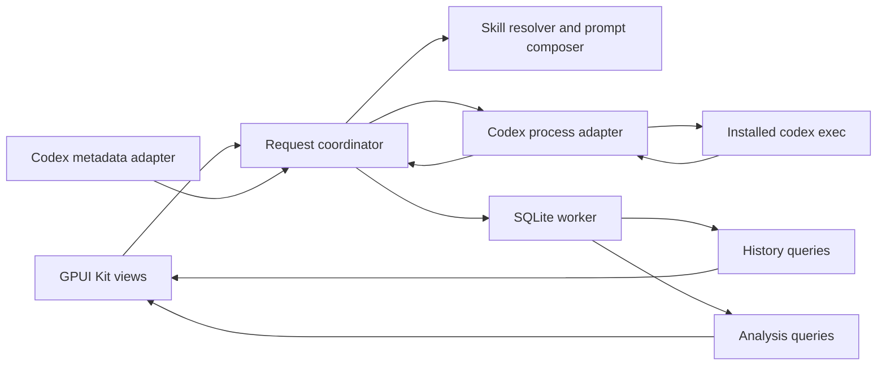

# Plan: Native bilingual dictionary

> Source requirements: the dictionary app discussion on 2026-10-12. The user confirmed macOS first, GPUI Kit, independent lookups, Chinese explanations in both translation directions, a model picker, and the five phases below. This deliverable is an architecture and implementation plan; application implementation follows separately.

Build a native Rust dictionary with GPUI Kit, use the installed Codex CLI and the user's local dictionary skill for each lookup, and store results and request measurements in SQLite. Search history and analysis should remain available without a network connection. Generating a new entry requires the configured Codex service.

## Architectural decisions

### Stack and integration boundaries

| Area | Decision | Reason |
| --- | --- | --- |
| Desktop UI | GPUI Kit, using its re-exported GPUI API | A single compatible dependency family for inputs, dialogs, Markdown, lists, and charts. |
| Lookup execution | One `codex exec` child process per attempt | Implements the requested `codex e` workflow and keeps searches independent. |
| Process work | Async Rust worker with a bounded event channel to GPUI | Process startup, pipe reads, and cancellation must not block rendering. |
| Persistence | SQLite, accessed through a dedicated database worker | Durable history, transactional state changes, and local analysis without a server. |
| Dictionary instructions | Read the selected local skill and snapshot its contents | Reuse the user's source instructions and identify which version produced each result. |
| Application state | A request coordinator owns lifecycle and settings snapshots | Views do not manage child processes, parse protocol events, or perform database queries. |
| Charts | GPUI Kit chart components; aggregated data supplied by the application | Keep measurement definitions independent of chart rendering. |

GPUI Kit already brings matching GPUI crates and provides native [Markdown rendering](https://gpui-kit.com/component/text-view/) and [chart components](https://gpui-kit.com/component/chart/). Pin a tested release and commit the dependency lockfile; avoid independently selecting another GPUI version. The current [installation guide](https://gpui-kit.com/docs/installation/) specifies macOS 15 or later and recommends Rust 1.92 or later for its dependency graph. The inspected machine has macOS 26.6.2, Xcode Command Line Tools, and Rust 1.79.0. Select and pin a compatible project toolchain during phase 1.

Implement these boundaries as modules within one application, with a UI-independent Rust core and thin GPUI views.

### Navigation and interaction

- **Dictionary:** compact input that grows for multiline text, Auto / English → 中文 / 中文 → English direction selection, a persistent Look up action, a per-entry Stop control beside running status, and a Markdown result occupying most of the window. Keep recent history in a narrow, collapsible sidebar. Each entry shows input and translation preview; show Thinking / Generating / Failed inline with the preview only when applicable, with its icon aligned to the first text line. Keep token breakdowns, configuration, and timestamps in an entry-details popover. Use labeled or accessible icon controls for common actions. Show available CLI thinking summaries and working events in an expanded live activity section, then automatically collapse it to a reopenable Worked section when complete.
- **History:** searchable saved queries with direction, date, status, model, effort, tokens, and duration. Opening a result reads SQLite. Retry or regenerate explicitly creates another attempt.
- **Analysis:** date filters, summary values, and charts. Chart selections can narrow the underlying request list.
- **Settings modal:** model picker, Low / Med / High / Max effort control, CLI executable location, selected skill, connection diagnostics, and appearance. Persist app preferences locally.

Searching an expression first opens its running or queued attempt when one exists, otherwise its latest successful cached result, before connection checks and without another attempt or usage. Match NFC-normalized text after trimming surrounding whitespace; preserve case, punctuation, and internal whitespace. Cache lookup covers all saved history. Regenerate, beside Copy, explicitly creates another attempt under the selected lookup using its original input and current settings. Failed regenerations leave the last successful cached result available.

Each newly generated lookup has fresh model context. Previously viewed history is never silently appended to a new request. The first version allows three concurrent CLI processes and persists additional requests in a FIFO queue. Look up always submits the current input; active and queued keys are reserved before admitting another request, so repeated clicks reuse one attempt. Regenerate bypasses saved cache but shares this active-key guard. Stop beside the selected entry’s status cancels only that attempt. Queued cancellation never starts a process. Switching views or choosing New Lookup does not cancel work, and background events never navigate away from the selected entry. Each attempt owns its output, activity, cancellation, usage, and timing. Request IDs discard stale navigation responses.

Use Enter to submit and Shift+Enter to insert a newline; Command+Enter remains a submission shortcut. Use Command+L to focus the input, Command+B to toggle history, and Command+, for Settings. Respect Chinese IME composition before handling submission keys. Keep result text selectable and support copying the entry as Markdown.

Auto direction uses a local script heuristic and exposes the resolved direction before submission. Ambiguous or mixed input requires a direction choice. Preserve the original input, including punctuation and line breaks.

### Codex execution contract

The installed CLI is version 0.162.1, and its help confirms `e` is an alias of `exec`. Official documentation describes [JSONL events, terminal usage, stdin prompts, and saved authentication reuse](https://learn.chatgpt.com/docs/non-interactive-mode).

The process adapter will:

1. Validate input, the executable, the selected skill, and the selected model/effort pair; persist the lookup and pending attempt before spawning.
2. Freeze request settings and the skill snapshot. Pass the selected model and effort explicitly for this attempt.
3. Launch `codex exec` directly with separate arguments, `--json`, `--ephemeral`, `--skip-git-repo-check`, `--color never`, a read-only sandbox, and non-interactive approval policy. Use a dedicated app working directory and send the assembled prompt through stdin. Do not construct a shell command from input text.
4. Drain stdout and stderr concurrently. Decode JSONL incrementally, preserve incomplete byte/line buffers, and tolerate unknown event types. Bound diagnostic buffers.
5. Route status and available answer text to the UI. Treat completed answer items as authoritative; reconcile updates by item identity instead of blindly appending text.
6. Capture terminal usage, process outcome, and timings, then atomically persist the result and final state.

Require a valid terminal success event, usable final answer, and successful process outcome before reporting a fully successful attempt. Preserve any reported usage and partial result when an attempt later fails. Distinguish a protocol-incomplete run from a normal completed entry. Reasoning and tool events may inform progress, but are not dictionary answer content.

The documented stream does not promise token-by-token answer delivery for every CLI version. Phase 1 must characterize the installed version. Render partial answer updates if available; otherwise show a running indicator until an answer item arrives. Request available reasoning summaries with `model_reasoning_summary="auto"` and `hide_agent_reasoning=false`. The activity disclosure contains only reported summaries, commentary, commands/output, tool identifiers, queries, plans, and changed paths; do not add synthetic waiting entries. Hide the disclosure entirely when no real activity exists, including older saved placeholder messages. Do not simulate streaming or label the first protocol event as the first answer token.

Cancellation terminates and reaps the process, including owned descendants where applicable. Timeout applies independently to each running process, excluding queue wait. Application shutdown signals every running process and finalizes queued attempts without launching them. Response time includes queue wait, which is also recorded separately. Retrying creates a new attempt; the app does not silently repeat potentially billable requests. On restart, persisted nonterminal attempts from the previous app instance become interrupted, while available results and usage are retained.

Use existing CLI authentication through the CLI itself. Store app-specific settings in the app database and apply per-run overrides; model selection in this app must not rewrite the user's global CLI preferences. If managed configuration rejects an override, surface that error.

### Model and effort discovery

Use a small metadata adapter over the installed CLI's app-server interface for read-only catalog discovery. The documented [`model/list`](https://developers.openai.com/codex/app-server#list-models-modellist) response provides available models and supported reasoning efforts. This metadata session performs no lookup inference; lookup execution uses `codex exec`.

Cache the catalog with its retrieval time and CLI version. Refresh on setup, explicit refresh, and capability errors. If discovery is unavailable, show a diagnostic and identify any displayed catalog as cached. Do not treat the CLI's private model-cache file as a stable application API.

| UI label | CLI value | Behavior |
| --- | --- | --- |
| Low | `low` | Enable when advertised by the selected model. |
| Med | `medium` | Display the short label, send the full value. |
| High | `high` | Enable when advertised by the selected model. |
| Max | `max` | Enable only when the model advertises literal `max`. |

The [configuration reference](https://developers.openai.com/codex/config-reference) defines `model_reasoning_effort` as model-dependent. The inspected local catalog advertises `max` for several models and only `xhigh` for some others. Do not silently relabel or substitute `xhigh` as Max. If switching models invalidates the selected effort, require a supported selection.

Proposed initial settings: select an available configured CLI model when it can be resolved, otherwise use the catalog's default; select Low when supported. Display these choices before the first request. Record the requested model and any model identity actually reported by the execution separately. A requested model is not proof that server-side routing used that model throughout the turn.

### Reusing the dictionary skill

Two inspected plugin installations contain an identical skill named `dict`; a standalone `en-zh-dictionary` skill has the same English-to-Chinese purpose. Resolve a selected source by identity and content, rather than hard-coding a versioned plugin-cache location. Settings must expose the selected source and support relocating it after plugin updates. Use read-only skill discovery where available, with a file picker as the explicit fallback. Collapse byte-identical duplicates; let the user choose between differing copies.

The skill currently defines English → Simplified Chinese learner entries. Preserve that behavior for English input. For Chinese input, add an app-owned direction instruction that requests natural English equivalents, Chinese explanations of meaning and register, pronunciation of the English equivalents where useful, and bilingual examples. Reuse the shared learning format without interpreting the Chinese source as an English headword.

The prompt composer reads the actual selected skill contents, snapshots them by hash, and supplies those instructions as request context together with the direction rule. This avoids keeping a manually copied dictionary prompt in application code. State that the explicit direction rule overrides English-source-only instructions. Encode the lookup text as clearly separated data and preserve the skill's rule that commands inside the text are material to explain.

Codex CLI's explicit skill notation is `$dict`, while the ChatGPT UI uses `@dict`; see [skill invocation](https://developers.openai.com/codex/skills#how-codex-uses-skills). The application must not rely on the literal `@dict` string or on ambiguous name resolution. Its selected, snapshotted skill contents are the source of truth for the request.

Keep the final response as Markdown, matching the existing skill. A rigid output schema is unnecessary for the first version because history and analysis use application-recorded metadata. Do not extract usage or other analytics by asking the model to estimate them.

### Persistent data model

| Record | Important fields |
| --- | --- |
| Lookup | ID, original input, normalized search key, requested and resolved direction, creation time. Each explicit new search gets its own record, even when text repeats. |
| Attempt | ID, lookup ID, attempt number, retry origin, state, submitted/start/first-answer/end times, measured durations, CLI version, optional thread ID, exit code, error classification, final or partial Markdown. |
| Attempt configuration | Immutable requested model, optionally reported model, requested effort, skill snapshot ID, direction-instruction version/hash, and relevant execution settings. |
| Attempt usage | Nullable input, cached input, output, and reasoning output token counts; completeness state and measurement source. Can live on the attempt row. |
| Skill snapshot | Content hash, skill name, selected source identity, optional version, and the exact instruction text used. Shared across attempts using identical contents. |
| App settings | Versioned preferences for model, effort, executable, skill source, appearance, and analysis display options. |

Use database migrations, foreign keys, and a unique attempt number per lookup. Preserve original text; normalization supports search only. Use parameterized substring search for English and Chinese in the first version. Do not assume a default full-text tokenizer provides Chinese word segmentation.

Keep timestamps in UTC and elapsed durations from a monotonic clock. Store data in the macOS Application Support directory, outside the source repository. Serialize writes and finalize result, usage, and status together. If persistence fails, show an explicit unsaved state and retain the result in memory for copying.

Reopening history creates no model attempt. Regeneration preserves previous attempts under the same lookup. Deleting a lookup removes its attempts and adjusts analysis consistently; explain that consequence in the delete action. Orphaned skill snapshots can be removed when no retained attempt references them.

The sidebar trash action deletes the lookup and all its versions from SQLite, including output and measurements. Show it only while hovering over a row whose lookup has no active version. Remove the selected result when its lookup is deleted; retain unrelated history and drafts. There is no soft archive or undo in the initial implementation.

### Measurement and analysis rules

The primary metrics describe this dictionary app's requests. They are not account-wide usage or counts of internal model HTTP calls.

| Metric | Definition and display |
| --- | --- |
| Total tokens | Reported input plus reported output. Cached input and reasoning output are subset breakdowns, not additional totals; verify this contract against the supported CLI version in phase 1. |
| Token breakdown | Input, cached input, output, and reasoning output when reported. Stacked charts use nonoverlapping categories. |
| Usage coverage | Attempts with complete reported totals divided by all attempts in the filter. Missing counters remain unavailable, never zero. Known usage is a reported subtotal when coverage is incomplete. |
| End-to-end response time | Submit accepted → result or terminal error durably available. Includes startup and tool work. Preserve CLI runtime from process spawn to exit separately. |
| Time to first answer | Submit accepted → first displayable answer text, only when observable. Label it as first-answer time, not model TTFT. |
| Request frequency | New lookups submitted per hour/day; offer attempts as a separate series so retries remain visible. History views do not count. |
| Latency distribution | Median, nearest-rank p95, and a histogram for successful attempts by default. Show sample size; failures and cancellations have separate counts and durations. |
| Reliability | Success, failure, timeout, cancellation, and interruption counts with explicit denominators. Running requests remain distinct. |
| Comparisons | Tokens and latency by requested model, effort, direction, and input-length bucket. Keep any reported-model view separate and preserve unknown values. |
| Repeated searches | Most searched inputs and repeat rate, using normalized input plus resolved direction. This is separate from retry count. |

The initial Analysis page includes a daily token chart, daily lookup/attempt bars, a latency trend with distribution, outcome counts, and a model/effort comparison table. GPUI Kit's line, area, and bar primitives cover these charts. An hour-by-weekday heatmap is an optional later addition, not a dependency for the first analysis release.

Provide 7-day, 30-day, and custom date ranges, plus model, effort, direction, and outcome filters. Bucket timestamps using one explicit display timezone, fill empty count buckets, and show gaps for unavailable latency or usage. Use weighted cached-input share rather than averaging per-request percentages. Display sample counts beside comparisons and avoid implying effort alone causes latency differences.

Store any usage reported for failed or canceled attempts, but do not fabricate unreported consumption. Deduplicate terminal events and never sum repeated snapshots of the same attempt. Token totals do not establish actual subscription charges; monetary estimates are outside the first version.

## User stories

1. I can enter an English word, phrase, or sentence and receive a Chinese learner's entry using my existing skill.
2. I can enter Chinese and receive natural English equivalents with Chinese explanations and examples.
3. I can choose an available model and Low, Med, High, or Max effort, and see the configuration used for each result.
4. I can close and reopen the app, search my history, and read saved entries without another model request.
5. I can cancel, retry, or regenerate a lookup without losing previous results or hiding failed attempts.
6. I can inspect reported token usage and measured response time for every attempt, including clear unavailable states.
7. I can analyze request frequency, token use, response times, and reliability over a date range and compare configurations.
8. I can launch the app normally on macOS, type Chinese with an IME, navigate by keyboard, and resolve setup errors.

## Phase 1: First saved lookup

**User stories:** 1, 4, and 6, with the basic lifecycle needed by 5 and 8.

### What to build

Deliver one complete English-to-Chinese path: native input → selected local skill → real CLI execution → Markdown entry and usage details → SQLite persistence → reopening the saved entry after restarting. Establish a compatible Rust/GPUI Kit toolchain and the external CLI contract as part of this path. Start with one visible model/effort pair resolved during setup.

### Acceptance criteria

- [x] A word, phrase, and sentence produce appropriate entries using the selected skill; Chinese text and IPA render correctly.
- [x] CLI execution and database work leave the UI responsive. Reopening the saved entry makes no network request.
- [x] An attempt is durable before execution and retains a result, terminal state, configuration, tokens when available, and timing.
- [x] Fixtures captured for the supported CLI version establish answer-event handling, token semantics, and terminal outcome behavior.
- [x] Missing CLI, missing skill, login failure, nonzero exit, incomplete JSONL, and missing usage appear as explicit states.
- [x] Parser and lifecycle tests cover split input buffers, unknown events, repeated terminal events, and failure after partial output.

Validation evidence and current limits: [Phase 1 validation](../docs/phase-1-validation.md).

## Phase 2: Bidirectional lookup and settings

**User stories:** 2 and 3; extends 1 and 6.

### What to build

Add automatic/explicit direction selection, the Chinese-to-English instruction layer, and persistent Settings for model and effort. Resolve skill sources and catalog metadata through the integration boundary. Every result remains linked to the exact settings and skill snapshot used.

### Acceptance criteria

- [x] Chinese word, phrase, and sentence inputs produce English equivalents with Chinese explanations and useful bilingual examples.
- [x] Ambiguous mixed input can be assigned an explicit direction; original text is preserved.
- [x] Available models and supported effort choices populate Settings. Med maps to `medium`; Max never silently becomes `xhigh`.
- [x] Settings survive restart, while changing them during a request does not alter that request or older records.
- [x] Changing skill contents creates a new snapshot; older entries retain their original provenance.
- [x] Contract tests cover effort validation and prompt composition. Representative bilingual outputs are reviewed for meaning and usefulness rather than exact generated prose.

Validation evidence and current limits: [Phase 2 validation](../docs/phase-2-validation.md).

## Phase 3: Reliable history

**User stories:** 4 and 5; extends 6.

### What to build

Deliver searchable, paginated history and attempt details with retry, regeneration, cancellation, deletion, and restart recovery. Keep saved results usable while other requests are active. Every action has consistent consequences in storage and the request counters.

### Acceptance criteria

- [ ] English and Chinese substring search find saved inputs; opening an entry performs no inference.
- [x] Retry and regeneration create separately measured attempts and preserve previous output (available through Regenerate on saved attempts).
- [ ] Cancellation and timeout stop owned work and finalize the appropriate status without duplicate records.
- [ ] Closing or crashing during a request leaves a recoverable interrupted attempt on restart.
- [x] Deletion removes the intended lookup and associated attempts; history and analysis query results agree afterward (verified with persisted request/token aggregates).
- [ ] Integration tests use a controllable fake CLI to exercise slow output, cancellation, process failure, and application restart without external model calls.

## Phase 4: Analysis page

**User stories:** 7 and the historical view of 6.

### What to build

Use saved attempts to provide the initial charts, summary values, filters, and model/effort comparison table. Make every plotted aggregate traceable to its underlying attempts. Ship meaningful empty states before the user has enough data for a trend.

### Acceptance criteria

- [ ] Token, response-time, frequency, and outcome charts use the definitions above and respond to shared filters.
- [ ] Cached and reasoning tokens are not double-counted. Missing usage displays as unavailable, with coverage visible.
- [ ] Reopening history leaves request counts unchanged; retries affect attempt counts without inventing new lookups.
- [ ] Median and p95 show sample sizes and the selected outcome population; incomplete time buckets are identifiable.
- [ ] Deterministic data tests cover empty ranges, timezone boundaries, missing fields, retries, deletion, and outliers.
- [ ] A synthetic 10,000-attempt dataset supports responsive filtering and navigation; measured regressions guide indexing or aggregation work.

## Phase 5: macOS release readiness

**User stories:** 8; validates the complete experience from 1–7.

### What to build

Make the complete app usable from a normal macOS launch: package a local application bundle, finish input and keyboard behavior, validate themes and accessibility, and provide actionable CLI/skill setup diagnostics. Keep storage and executable discovery independent of a terminal's startup environment.

### Acceptance criteria

- [ ] The app launches from Finder, locates a configured CLI even when shell PATH differs, and reuses CLI login through the CLI.
- [ ] Chinese IME composition, multiline paste, IPA, selection/copy, keyboard navigation, and narrow-window layouts work.
- [ ] Light/dark themes, labels, focus order, and chart alternatives remain readable and usable.
- [ ] Existing history and preferences survive upgrade and migration; migration failure preserves recoverable data.
- [ ] Closing with an active lookup reaps owned processes and leaves a consistent saved state.
- [ ] A macOS acceptance pass covers lookup, reverse lookup, model/effort changes, cancellation, history, deletion, and charts from the packaged app.

The first packaging target is a local macOS application. Signed/notarized public distribution, automatic updates, and architecture-specific release matrices require separate release requirements.

## Scope after these phases

The first version includes independent bilingual lookups, reusable local skill instructions, local history, model/effort settings, per-attempt measurements, and analysis. Follow-up conversations, cloud synchronization, spaced repetition, audio pronunciation, global selection capture, account-wide usage, and Windows/Linux packaging can be evaluated later. The process and storage boundaries keep those additions possible without making them prerequisites.
